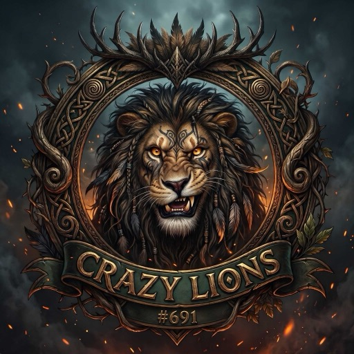

  

## Contents

### Events

- [VS + Turbo Turtle daily plan](guides/vs-turtle-daily.html): what to spend each day, points per item, CRL triple times, do's and don'ts

### Player Guide

- [Player Guide](guides/tiles-survive-guide.html)
  1. [Quick start](guides/tiles-survive-guide.html#c1)
  2. [Factions](guides/tiles-survive-guide.html#c2)
  3. [Heroes](guides/tiles-survive-guide.html#c3)
  4. [Gear](guides/tiles-survive-guide.html#c4)
  5. [Signature weapons](guides/tiles-survive-guide.html#c5)
  6. [Other squad power](guides/tiles-survive-guide.html#c6): Chief Collection, pets, titans
  7. [Settlement](guides/tiles-survive-guide.html#c7)
  8. [Research](guides/tiles-survive-guide.html#cR)
  9. [Stores](guides/tiles-survive-guide.html#c9)

## License

Content © Crazy Lions [CRL] #691, licensed under [CC BY-NC-SA 4.0](https://creativecommons.org/licenses/by-nc-sa/4.0/).
You may share and adapt it for non-commercial use, with credit to "Crazy Lions [CRL] #691", under the same license.

Tiles Survive game names, screenshots and art belong to their owners and are not covered by this license.
